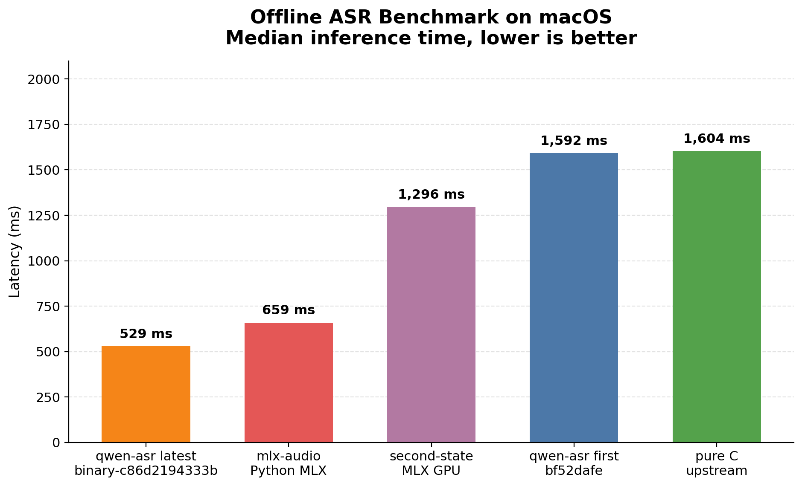
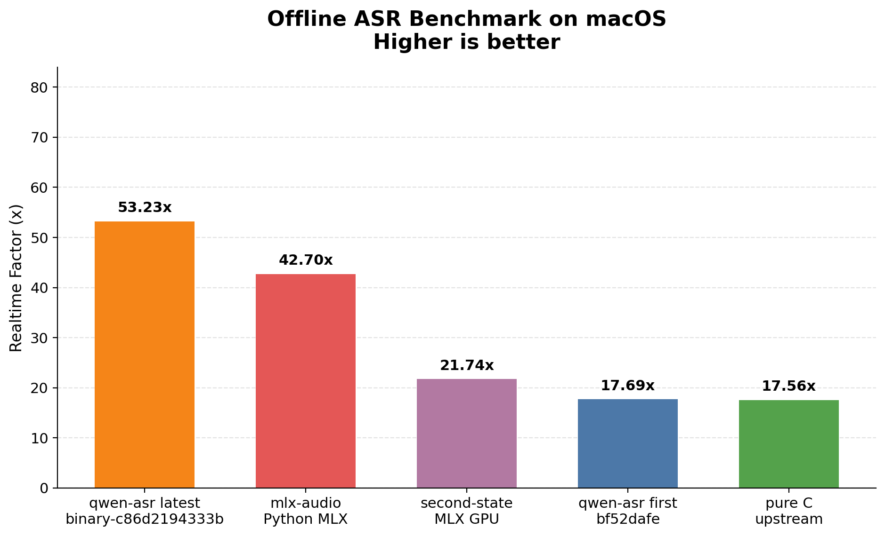

# qwen-asr

[](https://octocounts.com/?q=https%3A%2F%2Fgithub.com%2Fhuanglizhuo%2FQwenASR&ref=main)

A fast, pure-Rust, CPU-only inference engine for [Qwen3-ASR](https://huggingface.co/Qwen/Qwen3-ASR-0.6B) speech-to-text. It has no heavyweight runtime dependency—only `libc`—and is optimized for low-latency inference on Apple Silicon.

Supports the 0.6B and 1.7B models, offline and streaming transcription, live capture with VAD, subtitles, structured JSON, and forced alignment.

## Performance

On an Apple M5 Pro, the current 0.6B CPU build transcribes the **28.16-second**
benchmark clip in **581 ms inference / 693 ms end to end**
(medians of 10 standalone runs): **48.47× realtime** by inference time.

| Implementation | Median inference | Median process wall | Inference throughput |
|---|---:|---:|---:|
| qwen-asr (current CPU) | 581.0 ms | 693.4 ms | 48.47× |
| mlx-audio Python (GPU) | 746.3 ms | 1,630.4 ms | 37.73× |
| second-state MLX (GPU) | 1,439.7 ms | 1,679.7 ms | 19.56× |
| qwen-asr first port (CPU) | 1,647.0 ms | 1,984.2 ms | 17.10× |
| pure C upstream (CPU) | 1,653.5 ms | 1,922.5 ms | 17.03× |

<p float="left">
  
  
</p>

> Run started 2026-11-06; Apple M5 Pro, 15 cores, 48 GiB; 0.6B model family,
> each implementation's default configuration. Current build is the
> `r15-speedups` working tree, binary `de15033ee6e7…`, including uncommitted fixes.
> Background load was present. Native inference boundaries and quantization
> differ between implementations; wall time includes process startup/load/exit.
> See [versions, methodology and full comparison](docs/benchmarks/comparison.md).

Long-audio results (three measured runs per side, alternating against main):

| Audio / mode | Median inference | Median process wall |
|---|---:|---:|
| 120.705 s offline | 4.18 s | 4.29 s |
| 120.705 s segmented (-S30) | 2.52 s | 2.69 s |
| 602.465 s offline | 57.67 s | 57.87 s |
| 602.465 s segmented (-S30) | 11.13 s | 11.31 s |

In the November 6 R15 benchmark, all **17 cases** matched its main baseline,
including forced-alignment JSON.
On full LibriSpeech dev-clean, both builds scored **2.7591% offline WER**.
Of 2,703 utterances, 2,702 transcriptions matched exactly and one differed by
a comma. All 2,703 matched after WER normalization.

`qwen-asr` 0.11.2 completes the final file `--stream` decode, which
previously stopped after 32 tokens. November 7 follow-up results (three measured
runs per side on a loaded M5 Pro, 0.6B model, 12 threads):

| File `--stream` | WER before → after | Fixed median inference | Fixed median process wall |
|---|---:|---:|---:|
| 120.705 s | 91.7857% → **2.8571%** | 4.29 s | 4.41 s |
| 602.465 s | 98.3780% → **2.8914%** | 54.21 s | 54.39 s |

The old timings measured partial transcripts. A subsequent fix removes
destructive intermediate file-stream resets and reuses unchanged decode input.
File mode retains its deferred output defaults and complete context through EOF;
memory and decoding work grow with recording length.
[EOF fix](docs/benchmarks/2026-11-07-stream/README.md) and
[small-chunk fix, coverage checks and timings](docs/benchmarks/2026-11-07-stream-reset/README.md).

The latest allocation follow-up uses **0.5 s chunks**, comparing the complete
0.11.2 baseline with the current source in three alternating measured pairs on
a loaded M5 Pro. All transcripts are byte-identical; all 22 / 102 source
utterances retain matching text, with no beginning/end gap.

| File `--stream`, 0.5 s chunk | Unchanged WER | Inference baseline → current | Process wall baseline → current | Peak RSS baseline → current |
|---|---:|---:|---:|---:|
| 120.705 s | **2.8571%** | 7.463 → 7.406 s | 7.569 → 7.514 s | 3.440 → 3.430 GiB |
| 602.465 s | **2.6093%** | 186.650 → 182.250 s | 186.827 → 182.432 s | **8.943 → 7.265 GiB** |

The 10-minute peak-memory median drops **18.8%**. Its inference median improves
2.4%, but paired changes range from −3.7% to +3.0%; this is not evidence of a
stable speedup. All context is retained: the change reduces excess KV allocation
and repeated input preparation. Bounded-context variants failed the WER gate
and were not enabled. Small-chunk decoding remains more expensive than the
default deferred-output configuration.
[Allocation measurements and rejected context experiments](docs/benchmarks/2026-11-07-stream-context/README.md).
[All measurements and per-utterance comparison](docs/benchmarks/results.md).

## Quick Start

```bash
# Install
cargo install qwen-asr-cli

# Download model
qwen-asr download qwen3-asr-0.6b

# Transcribe
qwen-asr -d qwen3-asr-0.6b -i audio.wav
```

Or download a pre-built binary from [GitHub Releases](https://github.com/huanglizhuo/QwenASR/releases).

## Why qwen-asr is fast

- Hand-tuned NEON, Accelerate, and AMX-aware kernels for Apple Silicon
- Quantized decode weights and batched decoding paths that reduce memory traffic
- Dynamic scheduling across performance and efficiency cores
- No tensor framework, Python runtime, GPU dispatch, or server process

See the [optimization catalog](docs/optimizations/overview.md) for implementation details and the [research log](docs/research/) for measured experiments.

## Usage

```bash
qwen-asr -d qwen3-asr-0.6b -i audio.wav              # basic
qwen-asr -d qwen3-asr-0.6b -i audio.wav --silent      # transcript only
cat audio.wav | qwen-asr -d qwen3-asr-0.6b --stdin     # pipe from stdin
qwen-asr -d qwen3-asr-0.6b -i long.wav -S 30           # segmented
qwen-asr -d qwen3-asr-0.6b -i audio.wav --stream       # streaming
qwen-asr -d qwen3-asr-0.6b -i audio.wav --srt           # SRT subtitles
qwen-asr -d qwen3-asr-0.6b -i audio.wav --json out.json # structured JSON
qwen-asr -d qwen3-asr-0.6b -i audio.wav --aligner-dir qwen3-aligner-0.6b --srt out.srt --vtt out.vtt
qwen-asr -d qwen3-asr-0.6b --live --device "BlackHole 2ch"         # live capture (macOS)
qwen-asr -d qwen3-asr-0.6b --live --vad --device "BlackHole 2ch"   # VAD live
qwen-asr -d qwen3-aligner-0.6b -i audio.wav --align "Hello world" --align-language English  # alignment
```

<details>
<summary>All options</summary>

| Option | Description | Default |
|--------|-------------|---------|
| `-d <dir>` | Model directory (required) | — |
| `-i <file>` | Input WAV file | — |
| `--stdin` | Read audio from stdin (WAV or raw s16le 16kHz) | off |
| `--live` | Live capture from audio device (macOS) | off |
| `--device <name>` | Input device for live capture | system default |
| `--list-devices` | List audio input devices | — |
| `--vad` | VAD live mode | off |
| `-t <n>` | Thread count | performance cores |
| `-S <secs>` | Segment target seconds | 0 (full) |
| `--stream` | Streaming mode | off |
| `--stream-chunk-sec <s>` | Chunk size for streaming | 8.0 (2.0 for stdin) |
| `--language <lang>` | Force output language (`en`, `zh`, `ja`, ...) | auto |
| `--srt [path]` | Write SRT subtitles | `<input>.srt` |
| `--vtt [path]` | Write WebVTT subtitles | `<input>.vtt` |
| `--json [path]` | Write structured JSON; stdout when path is omitted | off |
| `--aligner-dir <dir>` | ForcedAligner model for word timestamps and sentence-level subtitles | off |
| `--silent` | Transcript only, no status output | off |
| `--profile` | Print timing breakdown | off |

</details>

## Output Formats

By default, `qwen-asr` prints plain text to stdout. Output flags are opt-in and can be combined; the audio is transcribed once and shared across requested outputs.

```bash
qwen-asr -d qwen3-asr-0.6b -i audio.wav --srt
qwen-asr -d qwen3-asr-0.6b -i audio.wav --vtt captions.vtt
qwen-asr -d qwen3-asr-0.6b -i audio.wav --json transcript.json
qwen-asr -d qwen3-asr-0.6b -i audio.wav --json
```

SRT and VTT use segment-level timestamps unless an aligner model is supplied. For sentence-level subtitle cues and JSON word timestamps, pass a Qwen3-ForcedAligner model:

```bash
qwen-asr -d qwen3-asr-0.6b -i audio.wav \
  --aligner-dir qwen3-aligner-0.6b \
  --srt captions.srt --vtt captions.vtt --json transcript.json
```

The JSON output has this shape:

```json
{
  "transcription_info": {
    "language": "en",
    "duration": 123.456
  },
  "text": "Full transcript text",
  "word_count": 42,
  "segments": [
    {
      "start": 0.000,
      "end": 8.750,
      "text": "Segment transcript text",
      "words": [
        { "word": "Shenyang,", "start": 1.120, "end": 1.440 }
      ],
      "word_count": 3
    }
  ],
  "vtt": "WEBVTT\n\n1\n00:00:01.120 --> 00:00:08.750\nSegment transcript text\n\n"
}
```

## Build

**Always use release mode.** Debug builds are 10–50× slower.

```bash
# macOS
RUSTFLAGS="-C target-cpu=native" cargo build --release

# Linux
sudo apt install libopenblas-dev   # Debian/Ubuntu
RUSTFLAGS="-C target-cpu=native" cargo build --release

# Without BLAS
RUSTFLAGS="-C target-cpu=native" cargo build --release --no-default-features

# iOS (static library + C-FFI)
cargo build --release --target aarch64-apple-ios --features ios

# Android (shared library + JNI)
cargo ndk -t arm64-v8a build --release --features android
```

| Feature | Description |
|---------|-------------|
| `blas` (default) | BLAS linking (Accelerate on macOS, OpenBLAS on Linux) |
| `vdsp` | Accelerate vDSP/vForce for AMX (macOS) |
| `ios` | C-FFI API |
| `android` | JNI API |

## Reproducing Benchmarks

```bash
# Speed benchmark
./bench/run.sh --samples-dir bench/samples/audio.wav --threads 12 --label current --runs 10

# WER benchmark (full 2,703-item LibriSpeech dev-clean offline)
python3 librispeech-wer-bench/librispeech_wer.py \
  --dataset librispeech-wer-bench/dev-clean-full \
  --binary target/release/qwen-asr \
  --model-dir qwen3-asr-0.6b \
  --output-dir librispeech-wer-bench/results \
  --label current-offline-full \
  --mode offline

# Cross-implementation comparison (30–60 min)
./bench/benchmark-all.sh --runs 10 --current-binary target/release/qwen-asr
```

See [`docs/benchmarks/`](docs/benchmarks/) for full details.

## Documentation

- [Benchmark methodology and results](docs/benchmarks/)
- [Optimization catalog](docs/optimizations/overview.md)
- [Research and experiment history](docs/research/)
- [Automated release process](RELEASE_PROCESS.md)

## OpenClaw Skill

One-command install for [OpenClaw](https://github.com/anthropics/openclaw) users:

```bash
bash skills/qwen-asr/scripts/install.sh
bash skills/qwen-asr/scripts/transcribe.sh audio.wav
```

## Acknowledgments

Rust port of [antirez/qwen-asr](https://github.com/antirez/qwen-asr), a pure C implementation of Qwen3-ASR inference by antirez.

## License

Same license as [antirez/qwen-asr](https://github.com/antirez/qwen-asr).
