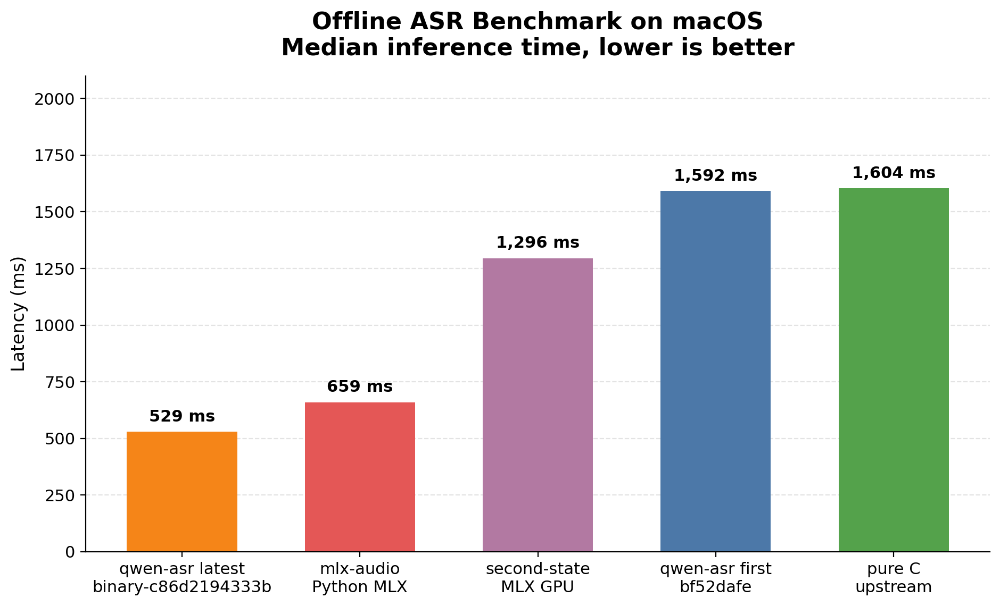
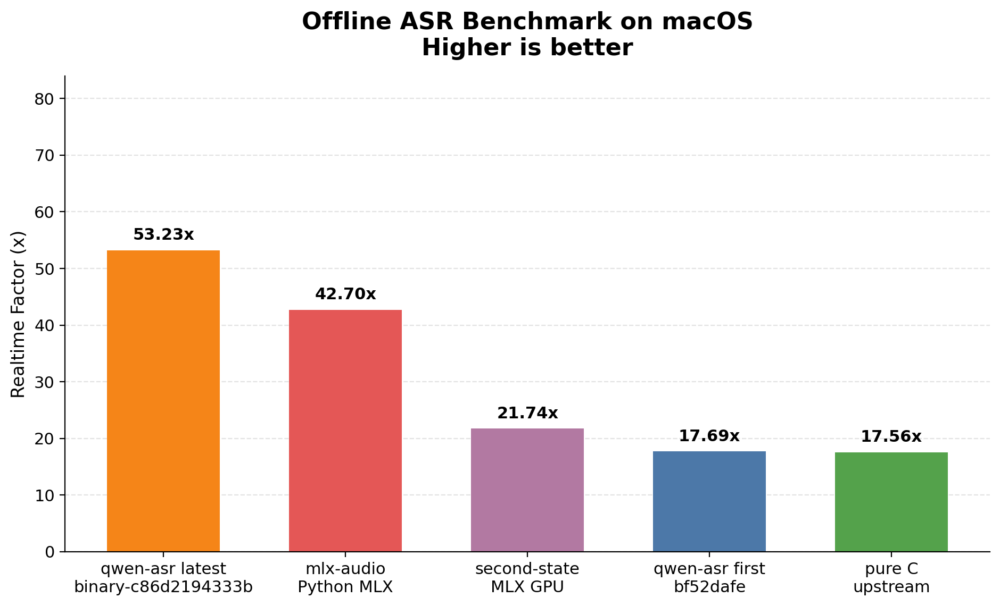

# Cross-Implementation Comparison

Fresh 2026-11-12 run on Apple M5 Pro (15 cores, 48 GiB). Each implementation
completed **10 successful standalone offline runs** on the same 28.16-second,
44.1 kHz mono WAV. No discarded warmup, no forced thread count; each engine
uses its shipped defaults. qwen-asr current selects 12 global threads and 10
single-token decode participants. Desktop processes kept running (1-minute
load average 2.0 at the start); this is not a controlled idle-machine ranking.

| Implementation | Median inference | Median process wall | Inference throughput |
|---|---:|---:|---:|
| qwen-asr (current CPU) | 529.0 ms | 633.9 ms | 53.23× |
| mlx-audio Python (GPU) | 659.5 ms | 1,462.6 ms | 42.70× |
| second-state MLX (GPU) | 1,295.6 ms | 1,464.1 ms | 21.74× |
| qwen-asr first port (CPU) | 1,591.5 ms | 1,908.8 ms | 17.69× |
| pure C upstream (CPU) | 1,603.5 ms | 1,858.6 ms | 17.56× |


## Interpretation

- These are Qwen3-ASR-0.6B **model-family** comparisons, not identical runtime
  or quantization configurations. mlx-audio uses the cached MLX 8-bit model;
  the CPU engines and second-state load the local model using their own paths.
- Native inference timers differ: the current Rust timer excludes resampling,
  while MLX file-path APIs include input preprocessing after model load. GPU
  work is synchronized for its inference timer. Process wall includes startup,
  model/input loading, inference and exit and is provided alongside inference.
- The first mlx-audio invocation took 1.473 s inference / 2.979 s wall
  and remains included in the ten-run statistics. Medians describe typical
  runs here, not guaranteed first-use latency; OS/runtime caches are uncontrolled.
- Throughput is 28.16 s divided by inference duration. All five engines ran
  sequentially in one script invocation. Do not interpret small differences
  as a statistically established ranking.
- Every engine measured faster than on 2026-11-06 (unchanged C upstream −3%,
  first port −3%, mlx-audio −12%, second-state −10%), so lighter background
  load explains part of qwen-asr's 581.0 → 529.0 ms. Interleaved A/B on this
  clip attributes −7.9% inference to the Round 16 code alone
  ([experiment log](../research/experiments.md)).
- Transcripts are not identical across all implementations; this speed comparison
  does not establish accuracy equivalence. Current-project WER and streaming
  limitations are documented in [results.md](results.md).

## Versions and evidence

- qwen-asr (current CPU): `binary-c86d2194333b`.
- mlx-audio Python (GPU): `0.4.5`.
- second-state MLX (GPU): `0226270`.
- qwen-asr first port (CPU): `bf52dafe`.
- pure C upstream (CPU): `9246942`.

The current binary SHA256 is
`c86d2194333bbb578bbf8ea107c194faef14ff2c4c816ddef921991047e057d2`, a clean
release build of `b6ed4ea4`.
mlx-audio is pinned to 0.4.5; its cached model revision is
`89e96d92ba34aca20b3e29fb10cc284097d1219f`.

[Normalized results](2026-11-12/cross/summary.json) ·
[All 50 timings](2026-11-12/cross/runs.json) ·
[System information](2026-11-12/cross/system_info.json) ·
[Complete run record](2026-11-12/README.md).
The previous [2026-11-06 run](2026-11-06/README.md) is kept for reference.

<p float="left">
  
  
</p>

## Reproduce

```sh
cargo build --release -p qwen-asr-cli
bash bench/benchmark-all.sh --runs 10 --current-binary target/release/qwen-asr
```

The explicit supplied binary avoids silently benchmarking clean HEAD instead
of local optimizations. Use the pinned versions/model path in the run record
for this exact comparison. External Metal builds require the Metal Toolchain
component; an installed macOS SDK alone is insufficient.
