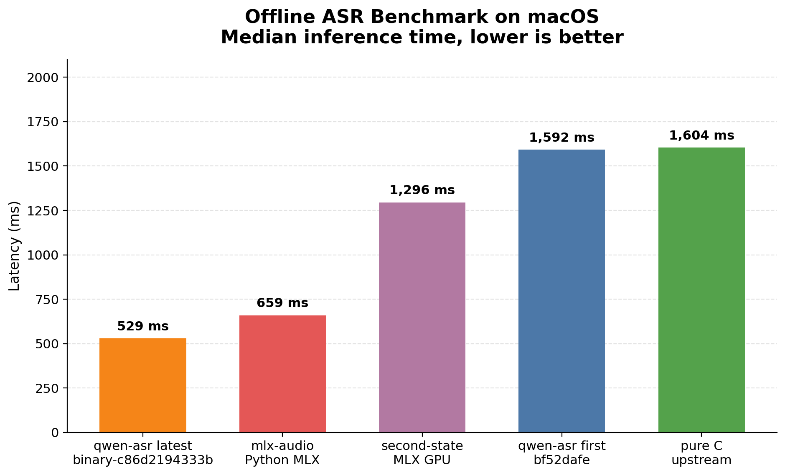
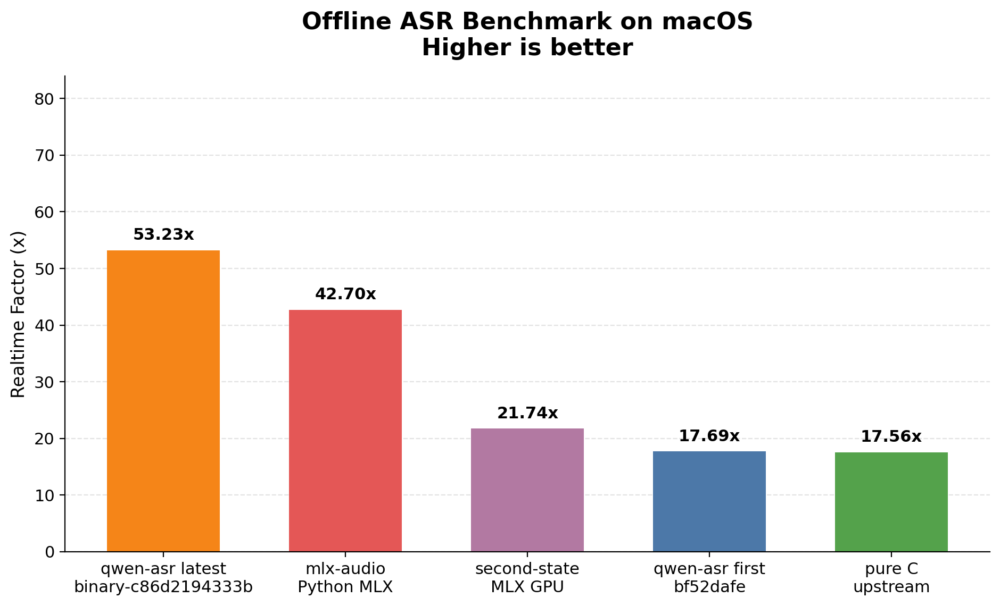

# Benchmark Report

## Methodology

- Offline benchmark on the same input WAV and Qwen3-ASR-0.6B model family across five implementations; quantization/runtime defaults differ.
- qwen-asr first: `bf52dafe`.
- qwen-asr latest: `binary-de15033ee6e7`.
- Upstream C: `antirez/qwen-asr`.
- GPU baselines: `second-state/qwen3_asr_rs` MLX and `mlx-audio` Python MLX.
- Implementations are benchmarked sequentially, not in parallel; each round is a standalone process invocation.
- Primary metric is median inference time across standalone rounds for every implementation.
- qwen-asr and pure C use their internal inference timers. MLX-based implementations are timed after model load with explicit GPU synchronization; their file-path APIs include input preprocessing, so inference boundaries differ.
- macOS Accelerate enabled for qwen-asr and pure C where applicable.
- Wall-clock time is retained as a secondary metric.
- Standalone rounds per target: `10`.
- Modes requested: `offline`.
- Results in the table and charts are sorted by median inference latency (fastest leftmost).

## Environment

- CPU: `Apple M5 Pro`
- Cores: `15 physical / 15 logical`
- Memory: `48.0 GB`
- Machine arch: `arm64`
- macOS: `26.7`
- Rustc: `rustc 1.97.1 (8bab26f4f 2026-07-14)`
- Model dir: `qwen3-asr-0.6b`
- Input file: `bench/samples/audio.wav`

## Results

| Implementation | Commit | Median inference ms | Mean ms | Best ms | RTF |
|---|---:|---:|---:|---:|---:|
| qwen-asr (latest) | `binary-de15033ee6e7` | `581` | `606` | `566` | `48.47x` |
| mlx-audio Python MLX | `0.4.5` | `746` | `2,593` | `726` | `37.73x` |
| second-state MLX GPU | `0226270` | `1,440` | `1,625` | `1,370` | `19.56x` |
| qwen-asr (first) | `bf52dafe` | `1,647` | `1,666` | `1,615` | `17.10x` |
| pure C upstream | `9246942` | `1,654` | `1,653` | `1,636` | `17.03x` |

Wall-clock timing

| Implementation | Commit | Median wall-clock ms | Mean ms | Best ms | Wall-clock RTF |
|---|---:|---:|---:|---:|---:|
| qwen-asr (latest) | `binary-de15033ee6e7` | `693` | `717` | `675` | `40.61x` |
| mlx-audio Python MLX | `0.4.5` | `1,630` | `3,748` | `1,582` | `17.27x` |
| second-state MLX GPU | `0226270` | `1,680` | `1,931` | `1,579` | `16.76x` |
| qwen-asr (first) | `bf52dafe` | `1,984` | `2,054` | `1,945` | `14.19x` |
| pure C upstream | `9246942` | `1,923` | `1,920` | `1,904` | `14.65x` |

## Findings

- qwen-asr latest `binary-de15033ee6e7` is `2.83x` the speed of qwen-asr first `bf52dafe`.
- qwen-asr latest `binary-de15033ee6e7` is `2.85x` the inference throughput of the upstream pure C implementation.
- qwen-asr latest `binary-de15033ee6e7` is `2.48x` the inference throughput of second-state MLX GPU.
- qwen-asr latest `binary-de15033ee6e7` is `1.28x` the inference throughput of mlx-audio Python MLX.

